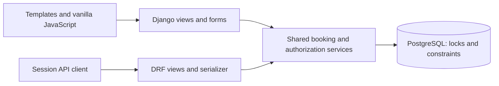

# Savannah Informatics Clinic Appointment Booking System

## 1. Project Overview

A Django/DRF appointment system for a small clinic with five demonstration doctors, weekly working hours and 30-minute slots. Patients view availability, book, cancel with a reason and reschedule. Public doctor pages and responsive patient, doctor and administrator dashboards support the assessment APIs.

Stack: Python 3.13, Django 5.2, Django REST Framework, PostgreSQL, Django Templates, Tailwind standalone CLI and vanilla JavaScript. No Node build is required.

Repository: [noelkips/clinic-appointment-booking-system](https://github.com/noelkips/clinic-appointment-booking-system), confirmed as Git origin; reviewer access/current remote contents remain unverified. The owner reports successful GitHub CI and deployment; live public checks and remaining demonstration-account verification are below.

### Live Demo and Test Accounts

[Live application](https://savannah-clinic-duil.onrender.com/) ? [Login](https://savannah-clinic-duil.onrender.com/accounts/login/). Read-only checks confirmed homepage, health and directory HTTP 200; login retrieval timed out. This does not verify account login or database contents.

| Role          | Prepared username ? not yet verified on Render | Features                                               |
| ------------- | ---------------------------------------------- | ------------------------------------------------------ |
| Administrator | demo_admin                                     | Staff dashboard/appointment oversight; not a superuser |
| Doctor        | demo_doctor                                    | Assigned visits and weekly schedule                    |
| Patient       | demo_patient                                   | Booking, cancellation and rescheduling                 |

No passwords are published here. See [controlled seeding and verification](docs/LIVE_DEMO_TESTING_GUIDE.md), [actual verification status](docs/LIVE_DEMO_VERIFICATION.md) and [cleanup plan](docs/DEMO_DATA_CLEANUP_GUIDE.md). The existing local-only seeder remains restricted; the new hosted command requires explicit target confirmation and is never run automatically.

## 2. System Design and Technical Decisions

A Django monolith shares authentication, ORM and booking services between HTML forms and REST views. It keeps operations simple for five doctors while supporting growth through indexing, aggregation and pagination before distributed infrastructure.

PostgreSQL provides transactions, row locks and GiST exclusion constraints. Services lock Doctor then Patient, validate, save and record an event atomically; appointment changes also lock the appointment. Conditional unique constraints and half-open 30-minute interval exclusions prevent doctor and patient overlap, including direct SQL writes. Adjacent visits are allowed. Database guards do not enforce every business rule for direct maintenance edits.

Slots are derived from weekly periods rather than pre-generated rows. This supports breaks without extra slot storage; leave, holidays, overnight shifts and variable durations need future policy. Dashboards currently use repeated counts and unpaginated lists. Event history does not retain old/new timestamps. These are scalability/history trade-offs, not missing mandatory endpoints.

This describes the implemented design retrospectively.

I did write a comprehensive 'SRS' as my understanding on the assignment that helped me to prompt AI effectively Flow chart below shows the design

## 3. Data Models and Architecture

| Model              | Main fields / relationships                                                                                  |
| ------------------ | ------------------------------------------------------------------------------------------------------------ |
| Doctor             | One-to-one User, specialty, biography, is_available                                                          |
| Patient            | One-to-one User, phone                                                                                       |
| DoctorAvailability | Doctor FK, weekday, start_time, end_time, slot_minutes=30                                                    |
| Appointment        | Protected Doctor/Patient FKs, starts_at, reason, cancellation_reason, confirmed/cancelled status, created_at |
| AppointmentEvent   | Appointment FK, nullable User actor, booked/rescheduled/cancelled action, occurred_at                        |



Django User `is_staff` means application administrator; otherwise Doctor/Patient profiles determine role. Patients access their own records, doctors assigned visits and personal schedules, staff clinic management. Registration creates patients only. Login redirects to `/dashboard/`, `/doctor-dashboard/` or `/platform/`. Session-authenticated mutations and POST logout require CSRF. The maintenance UI is `/django-admin/`, with separate Django model permissions. Password recovery is informational, not an email reset feature.

## 4. REST API and Booking Rules

All APIs require a login session; retain cookies and supply CSRF for unsafe requests. No bearer-token endpoint exists. Paths have **no trailing slash**; equivalent root aliases without `/api` exist.

| Method / route                                       | Input                                                  | Success / common errors                                                      |
| ---------------------------------------------------- | ------------------------------------------------------ | ---------------------------------------------------------------------------- |
| POST `/api/appointments`                             | doctor PK, starts_at; optional reason (200 characters) | Patient only; 201 appointment; 400 validation; 409 conflict                  |
| GET `/api/doctors/{id}/availability?date=YYYY-MM-DD` | Doctor PK/date                                         | 200 date + ISO slots; 400 invalid date; 404 doctor                           |
| PATCH `/api/appointments/{id}/cancel`                | reason, trimmed nonblank string ≤500                   | Owner/staff; 200 cancelled representation; 400 repeat/invalid reason         |
| PATCH `/api/appointments/{id}/reschedule`            | starts_at, same doctor                                 | Owner/staff; 200 updated representation; 400 invalid/cancelled; 409 conflict |
| GET `/api/patients/{id}/appointments`                | Patient profile PK                                     | Owner/staff; 200 future confirmed visits sorted by date then ID              |

Anonymous/forbidden/CSRF requests return 403; inaccessible appointment objects return 404. Illustrative booking body: `{"doctor":1,"starts_at":"2026-11-02T09:00:00+03:00","reason":"Consultation"}`. Obtain a genuinely free future timestamp from availability; examples are not reservations. See [complete API requests, responses and errors](docs/API_REFERENCE.md).

Appointments must fit a complete 30-minute period and align to its grid; doctors must be active/available. Past starts and starts **at or before one hour from now** are rejected. This strict equality policy resolves the bonus requirement conservatively. Times are aware; schedules/displays use Africa/Nairobi. Explicit ISO offsets are recommended.

Cancelled records occupy no slot. Cancellation retains the original consultation reason separately. Only future confirmed visits can change. Rescheduling validates like a fresh booking, releases the old interval on success and leaves it intact on failure. Availability reflects doctor freedom; patient overlaps across doctors are checked on submission. Five doctors is data, not a model limit. CRUD functions can be added in fruture to help manage DOCTOrs other tan sticking to the 5 doctors

## 5. Local Setup

The Git root contains the inner application folder. Run these **fresh-environment** steps from a new checkout; preserve an existing `.env` and populated database:

```powershell
git clone https://github.com/noelkips/clinic-appointment-booking-system.git
Set-Location clinic-appointment-booking-system\clinic-appointment-booking-system
py -3.13 -m venv .venv
.\.venv\Scripts\Activate.ps1
python -m pip install -r requirements.txt
Copy-Item .env.example .env
python -c "import secrets; print(secrets.token_urlsafe(48))"
```

Create a local PostgreSQL role/database, enable `btree_gist`, then privately configure `DJANGO_SECRET_KEY`, `DATABASE_URL`, `DJANGO_DEBUG=True` and local `DJANGO_ALLOWED_HOSTS`. Percent-encode reserved password characters in connection URLs. Supported proxy/origin controls are in `.env.example`; leave proxy trust off locally. Never commit secrets.

```powershell
python manage.py check
python manage.py migrate
python manage.py createsuperuser
python manage.py runserver 127.0.0.1:8000
```

Open `http://127.0.0.1:8000/`. Fresh data needs Doctor/DoctorAvailability records. Existing demonstration data needs no reseeding. Inspect `python manage.py seed_demo --help` for development-only safeguards; private accounts remain in ignored `docs/LOCAL_TEST_ACCOUNTS.md`.

Compiled CSS is included. If rebuilding with the separately obtained standalone Tailwind v4.1.18 binary:

```powershell
.\.local\tailwindcss.exe -i static/src/input.css -o static/css/tailwind.css --minify
python manage.py collectstatic --noinput --ignore=src
```

[Detailed Windows/PostgreSQL setup, environment, backup/restore and demo guide](docs/LOCAL_DEVELOPMENT_GUIDE.md).

## 6. Testing

Use local PostgreSQL test credentials with CREATEDB and extension permissions; Django uses the separate `test_clinic_local` database.

```powershell
python manage.py check
python manage.py makemigrations --check --dry-run
python -m pip check
python manage.py test --settings=config.test_settings --keepdb --noinput --verbosity 2
# Focused production infrastructure regressions:
python manage.py test config.test_production --settings=config.test_settings --keepdb --noinput
```

**Current local result: 100 tests passed in 36.647s on PostgreSQL, no skips**, including concurrency, secret/health/proxy checks and eight new assessment-seeding regressions. Production checks/static/WSGI smoke checks also passed after excluding Tailwind source from collection. See [deployment validation and limits](docs/RENDER_DEPLOYMENT_GUIDE.md#local-validation).

## 7. Deployment and CI/CD

[CI workflow](../.github/workflows/ci.yml) is at the **Git root**, runs on PRs targeting `main` and pushes to `main`, and uses Ubuntu, pinned Python, PostgreSQL 18.6, extension setup, migration checks, the full suite, production checks and static collection. Its token has contents-read permission only. Test fixture seeding is isolated; no standalone demo seed step runs.

[Render blueprint](render.yaml) uses the inner application root, Python 3.13.12, exact dependencies, Gunicorn, managed PostgreSQL, `/health/` and `main`. Render's `checksPass` integration is the sole planned automatic deployment mechanism: a protected PR merge produces a main push check, then Render deploys after CI passes. No competing deploy hook/job exists. RootDir filtering can skip redeploys for changes outside the application folder.

Free-plan preparation runs migrations at build time because pre-deploy commands require paid compute.

Production uses secure cookies, HTTPS redirect, explicit trusted proxy opt-in, configurable CSRF origins, manifest static files, console logging and one-hour host-only HSTS. HSTS subdomain/preload advisory checks are deliberately silenced until domain policy is confirmed. This is configuration preparation, not proof of production security.

**The owner reports hosted CI/deployment success; end-to-end merge/deployment evidence has not been independently audited in this task.** Follow [Render deployment and GitHub setup guide](docs/RENDER_DEPLOYMENT_GUIDE.md). The live URL above was checked read-only. CI/CD assessment completion requires a successful hosted PR run and a real merged PR resulting in a successful public deployment.

## 8. AI Reflection

1. **AI use across sections:** observed assistance includes source/design review, API remediation/verification, documentation and current CI/production preparation.

2. **Useful suggestion and actual prompt:** the boundary guard/regressions fixed availability on `9999-12-31`. Recorded triggering instruction: “Begin Task 4 now. Verify the running application against PostgreSQL, fix confirmed defects and produce the verification report.” **TODO (developer): confirm this personal example or supply your preferred actual prompt.**

3. **Wrong/incomplete output:** AI initially expected rescheduling into a doctor-free slot to succeed despite that patient's existing conflict. The API correctly returned 409; the harness was corrected and rerun. This is an evidenced AI testing mistake; application defect authorship is not inferred.
   Also the UI was looking bad, i had ro prompt and follow up untill I got the better UI that can can be used for testing

**TODO (developer): confirm or replace with your own evidenced experience.** 4. **Independent decisions:** **TODO (developer): identify two decisions made without AI and why you trusted your own judgment.**

THE UI design, and also the seeding of demo data including several documentation that I had to explicitly instruct AI to generate that will serve as my future reference

## 9. Project Structure and Supporting Documentation

```text
<git-root>/
├── .github/workflows/ci.yml
├── .gitattributes
└── clinic-appointment-booking-system/
    ├── manage.py, requirements.txt, render.yaml, .env.example
    ├── config/       # settings, URLs, WSGI, health and production tests
    ├── clinic/       # models, services, API/serializer, forms, views, tests
    │   ├── migrations/  # 0001–0004; interval guards retained
    │   └── management/commands/seed_demo.py
    ├── scripts/render-build.sh
    ├── templates/, static/
    └── docs/
```

- Original four-section assessment is the source of truth; the expected PDF is absent from this checkout. Restore your original review copy before submission.
- [Deployment guide](docs/RENDER_DEPLOYMENT_GUIDE.md) — exact setup, validation, rollback and pending external evidence.
- [API reference](docs/API_REFERENCE.md) and [local development guide](docs/LOCAL_DEVELOPMENT_GUIDE.md).
- [Final audit](docs/FINAL_ASSESSMENT_COMPLIANCE_AUDIT.md) — historical pre-CI matrix with current preparation note.
- [Functional verification](docs/APPLICATION_FUNCTIONAL_VERIFICATION.md), [earlier audit](docs/ASSESSMENT_COMPLIANCE_AUDIT.md), [implementation history](docs/IMPLEMENTATION_REPORT.md).
